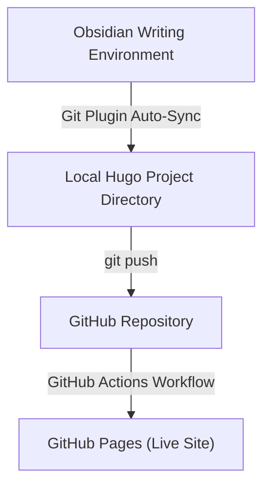

For years, writers and developers have wrestled with traditional hosted content platforms (CMS like WordPress) that lock data behind proprietary databases, inject unwanted advertisements, or impose rigid stylistic templates. Recently, I decided to take complete ownership of my digital footprint.

I wanted a publishing workflow that felt as clean and precise as writing code: pure Markdown files managed in a Git repository, built instantly, and hosted for free-all without sacrificing a rich authoring experience.

Here is the exact blueprint of how I set up my personal blog using **Hugo**, **Obsidian**, **Git**, **GitHub**, **GitHub Actions**, and **GitHub Pages**.

***full code in github repo https://github.com/nirmalghub/nirmalghub.github.io***

---

## The Tech Stack & Workflow

Instead of relying on a heavy backend Content Management System (CMS) like WordPress, I opted for a modern, static site architecture paired with a dedicated local writing environment:

* **Hugo (v0.167.0-extended):** An ultra-fast static site generator written in Go, capable of compiling entire websites in milliseconds. 
* **PaperMod (Git submodule):** A minimalist, fast, and accessible Hugo theme. 
* **Obsidian:** A distraction-free, local-first Markdown editor that serves as my personal writing studio.
* **Obsidian Git plugin (Vinzent03):** Local Workflow. Local Hugo directory linked directly as an Obsidian Vault. Automated Git sync via the Obsidian Git plugin.
* **Git & GitHub:** Version control to track changes and host the underlying public repository.
* **GitHub Actions:** A CI/CD pipeline that automatically compiles and deploys the site whenever new content is pushed.

---


---

## 1. Setting Up the Local Hugo Engine

Getting started locally on Windows was remarkably straightforward. First, I installed Hugo via the terminal:

```bash
winget install Hugo.Hugo.Extended
```

Next, I initialized the site structure and added the PaperMod theme as a Git submodule:

```bash
hugo new site my-blog
cd my-blog
git init
git submodule add --depth=1 https://github.com/adityatelange/hugo-PaperMod.git themes/PaperMod
```

A minimal `hugo.toml` looks like this:

```toml
baseURL = "https://username.github.io/repo-name/"   # change to your actual URL
languageCode = "en-us"
title = "My Blog"
theme = "PaperMod"
```

My own version of `hugo.toml` looks like this:

```toml

```

After that, create your first post and preview locally:

```bash
hugo new content posts/hello-world.md
hugo server -D
```

Configuring the site further (PaperMod params, menus, etc.) is just a matter of expanding the same `hugo.toml` file.

---

## 2. Elevating the Writing Experience with Obsidian

While raw text editors like VS Code or Notepad give you complete control, writing long-form prose in a code editor can feel mechanical. To create a smooth writing environment without giving up Git control, I brought in **Obsidian**.

### How it Works:

1. **Open Hugo as a Vault:** In Obsidian, I used **Manage Vaults → Open folder as vault** and selected my local Hugo project directory.
2. **Automated Publishing via Git Plugin:** I installed the **Git** community plugin (by Vinzent03) inside Obsidian.

Now, I can write posts inside Obsidian using live preview, formatting shortcuts, and dark mode. When finished, I run a simple `Commit and sync` command directly within Obsidian, which handles the background `git add`, `commit`, and `push` to GitHub.

> **Note:** Set up a GitHub Personal Access Token (or SSH key) so the plugin can push without interactive prompts.

---

## 3. Automating Cloud Deployment with GitHub Actions

One of the most satisfying aspects of this setup is separating **source code** from **compiled web pages**.

By adding a `.gitignore` file that excludes the generated `public/` folder, my Git repository stays lightweight—containing only raw Markdown posts, configuration, and themes.

To make GitHub build the site automatically, I added a workflow file at `.github/workflows/hugo.yml`:

```yaml
name: Deploy Hugo site to Pages

on:
  push:
    branches: ["main"]
  workflow_dispatch:

permissions:
  contents: read
  pages: write
  id-token: write

concurrency:
  group: "pages"
  cancel-in-progress: false

jobs:
  build:
    runs-on: ubuntu-latest
    steps:
      - name: Checkout
        uses: actions/checkout@v4
        with:
          submodules: recursive
          fetch-depth: 0

      - name: Setup Hugo
        uses: peaceiris/actions-hugo@v3
        with:
          hugo-version: '0.167.0'   # pin the version for reproducibility
          extended: true

      - name: Setup Pages
        id: pages
        uses: actions/configure-pages@v4

      - name: Build with Hugo
        env:
          HUGO_ENVIRONMENT: production
          HUGO_BASEURL: ${{ steps.pages.outputs.base_url }}/
        run: |
          hugo \
            --minify \
            --baseURL "${{ steps.pages.outputs.base_url }}/"

      - name: Upload artifact
        uses: actions/upload-pages-artifact@v3
        with:
          path: ./public

  deploy:
    environment:
      name: github-pages
      url: ${{ steps.deployment.outputs.page_url }}
    runs-on: ubuntu-latest
    needs: build
    steps:
      - name: Deploy to GitHub Pages
        id: deployment
        uses: actions/deploy-pages@v4
```

Now, pushing from Obsidian triggers a cloud build that updates the live site in under 30 seconds.

---

## Real-World Gotchas Along the Way

Every setup comes with a learning curve. Here are a few things I resolved during the initial build:

1. **TOML Configuration Strictness:** Hugo’s `hugo.toml` expects strict key-value formatting and matching quotes. Unclosed strings or unescaped characters will throw unmarshal errors during build.
2. **Deprecation Warnings in Newer Hugo Versions:** Hugo v0.158+ deprecated keys like `languageCode` in favor of `locale`. Keeping theme submodules updated ensures zero build warnings.
3. **Repository Naming vs. Root Domain:** GitHub Pages serves standard repositories as project subfolders (`username.github.io/repo-name/`). Naming the main repository `username.github.io` converts it into a clean, root-level landing site.
4. **Mermaid.js Diagram Support:**  
   - Obsidian renders Mermaid natively, but Hugo just emits plain code blocks.  
   - I solved it with a small script in `layouts/partials/extend_footer.html` that finds those blocks on page load and converts them into proper Mermaid diagrams:

   ```html
   <script src="https://cdn.jsdelivr.net/npm/mermaid@10/dist/mermaid.min.js"></script>
   <script>
     document.addEventListener("DOMContentLoaded", function () {
       const mermaidBlocks = document.querySelectorAll(
         "code.language-mermaid, pre.language-mermaid, div.highlight .language-mermaid"
       );

       mermaidBlocks.forEach((block) => {
         const container = document.createElement("div");
         container.className = "mermaid";
         container.textContent = block.textContent;

         const parent = block.closest("div.highlight") || block.parentElement;
         parent.parentNode.replaceChild(container, parent);
       });

       mermaid.initialize({ startOnLoad: true, theme: "dark" });
     });
   </script>
   ```
---

## Final Thoughts

Moving away from walled-garden blogging platforms has been deeply liberating. Writing in plain text, version-controlling every thought with Git, and deploying via automated pipelines means my content is completely portable, fast, and future-proof.

If you are looking for a friction-free, developer-friendly way to share your ideas, give Hugo, Obsidian, and GitHub Pages a try!

---