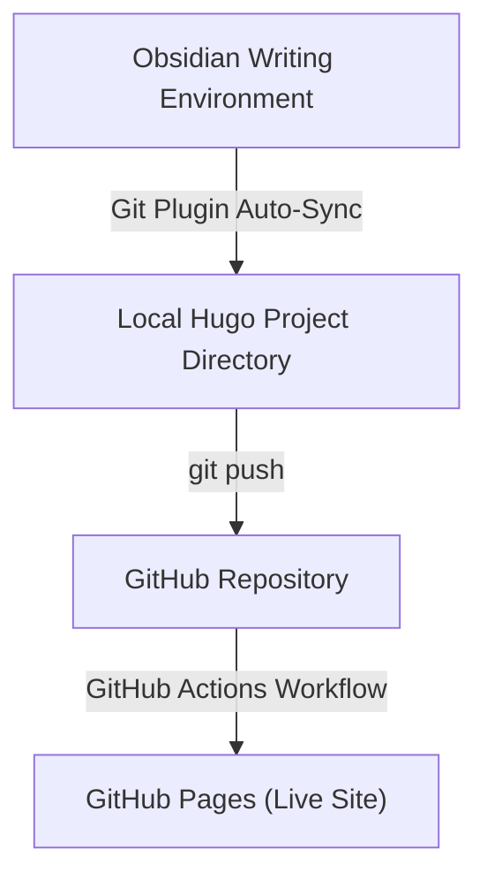

Traditional CMS platforms like WordPress lock your content behind a database, inject ads, or force rigid templates. I wanted the opposite: a publishing workflow as clean as writing code, with plain Markdown files in a Git repository, built instantly, and hosted for free.

The result: **₹0/month, a full site build in milliseconds, and about 30-50 seconds from "Commit and sync" in Obsidian to live on the internet.** Below is the exact setup using Hugo, Obsidian, Git, GitHub Actions, and GitHub Pages.

> 📦 Full source: [github.com/nirmalghub/nirmalghub.github.io](https://github.com/nirmalghub/nirmalghub.github.io)


---

## The Stack

* **Hugo (v0.167.0-extended):** a static site generator written in Go that compiles entire sites in milliseconds.
* **PaperMod:** a minimalist, fast, accessible Hugo theme, added as a Git submodule.
* **Obsidian:** a local-first Markdown editor that serves as my writing studio.
* **Obsidian Git plugin (by Vinzent03):** commits and pushes from inside Obsidian.
* **GitHub + GitHub Actions + GitHub Pages:** hosting, CI/CD, and free serving of the built site.

**Prerequisites:** a GitHub account, [Git](https://git-scm.com/) installed, and basic comfort with a terminal. I used Windows; the Hugo install command is the only OS-specific part.

The whole pipeline:



---

## 1. Set Up the Local Hugo Site

Install Hugo (Windows):

```bash
winget install Hugo.Hugo.Extended
```

Create the site and add the PaperMod theme as a submodule:

```bash
hugo new site my-blog
cd my-blog
git init
git submodule add --depth=1 https://github.com/adityatelange/hugo-PaperMod.git themes/PaperMod
```

A minimal `hugo.toml`:

```toml
baseURL = "https://username.github.io/"
locale = "en-us"
title = "My Blog"
theme = "PaperMod"
```

Here are the handful of extra settings I actually recommend adding under `[params]`:

```toml
[params]
  ShowReadingTime = true       # "5 min read" under each title
  ShowCodeCopyButtons = true   # copy button on code blocks
  ShowBreadCrumbs = true       # simple navigation trail
  defaultTheme = "auto"        # follow the visitor's light/dark preference

[markup.goldmark.renderer]
  unsafe = true                # allow raw HTML inside Markdown
```

PaperMod also has a "profile mode" landing page, menus, and social icons. My complete config is in the [repo](https://github.com/nirmalghub/nirmalghub.github.io) if you want to copy from it.

Create a first post and preview locally:

```bash
hugo new content posts/hello-world.md
hugo server -D
```

---

## 2. Write in Obsidian, Publish with Git

Writing long-form prose in a code editor feels mechanical. Obsidian fixes that without giving up Git.

1. **Open Hugo as a vault:** in Obsidian choose **Manage Vaults → Open folder as vault** and select your Hugo project folder.
2. **Install the Git plugin:** *Settings → Community plugins → Browse → "Git"* (by Vinzent03), then enable it.
3. **Publish:** write with live preview, then run the **Git: Commit and sync** command from the command palette. The plugin handles `git add`, `commit`, and `push`.


### Don't commit Obsidian's noise

Opening the folder as a vault creates a `.obsidian/` directory. Its workspace file changes every time you click anything, which causes constant noisy commits. Add a `.gitignore` at the project root:

```gitignore
public/
.hugo_build.lock
resources/_gen/
.obsidian
```

Ignoring `public/` keeps the repository light: only Markdown, config, and the theme, never the compiled output. Committing the rest of `.obsidian/` is fine and keeps your plugin settings portable across machines.

### Let the plugin push without prompts

The plugin can't answer password prompts, so set up non-interactive authentication. SSH is the simplest:

```bash
ssh-keygen -t ed25519 -C "you@example.com"
# add the contents of ~/.ssh/id_ed25519.pub at GitHub → Settings → SSH and GPG keys
git remote set-url origin git@github.com:username/username.github.io.git
```

Prefer HTTPS? Use a Personal Access Token and let Git Credential Manager (bundled with Git for Windows) store it on the first push.

---

## 3. Deploy Automatically with GitHub Actions

### Step 1: Name the repo correctly

GitHub Pages serves a normal repo at `username.github.io/repo-name/`. Name your repo exactly `username.github.io` and it is served from the clean root `username.github.io`.

### Step 2: Switch Pages to GitHub Actions

Go to **Repository → Settings → Pages → Build and deployment → Source** and choose **GitHub Actions**.

This is the step people miss. Without it, the workflow below runs successfully and nothing gets deployed.

### Step 3: Add the workflow

Create `.github/workflows/hugo.yml`:

```yaml
name: Deploy Hugo site to Pages

on:
  push:
    branches: ["main"]
  workflow_dispatch:

permissions:
  contents: read
  pages: write
  id-token: write

concurrency:
  group: "pages"
  cancel-in-progress: false

jobs:
  build:
    runs-on: ubuntu-latest
    steps:
      - name: Checkout
        uses: actions/checkout@v4
        with:
          submodules: recursive
          fetch-depth: 0

      - name: Setup Hugo
        uses: peaceiris/actions-hugo@v3
        with:
          hugo-version: '0.167.0'   # pin the version for reproducibility
          extended: true

      - name: Setup Pages
        id: pages
        uses: actions/configure-pages@v4

      - name: Build with Hugo
        env:
          HUGO_ENVIRONMENT: production
        run: hugo --minify --baseURL "${{ steps.pages.outputs.base_url }}/"

      - name: Upload artifact
        uses: actions/upload-pages-artifact@v3
        with:
          path: ./public

  deploy:
    environment:
      name: github-pages
      url: ${{ steps.deployment.outputs.page_url }}
    runs-on: ubuntu-latest
    needs: build
    steps:
      - name: Deploy to GitHub Pages
        id: deployment
        uses: actions/deploy-pages@v4
```

Push to `main` and the **Actions** tab shows the build. About 30-50 seconds later the site is live.


---

## 4. Bonus: Mermaid Diagrams

Obsidian renders Mermaid natively, but Hugo just emits a plain code block. A small script converts those blocks into diagrams in the browser.

Create `layouts/partials/extend_footer.html`. Wrapping it in `{{ if .Params.mermaid }}` means the library loads only on posts that need it, which keeps every other page fast:

```html
{{ if .Params.mermaid }}
<script src="https://cdn.jsdelivr.net/npm/mermaid@10/dist/mermaid.min.js"></script>
<script>
  document.addEventListener("DOMContentLoaded", function () {
    const blocks = document.querySelectorAll(
      "code.language-mermaid, pre.language-mermaid, div.highlight .language-mermaid"
    );

    blocks.forEach((block) => {
      const container = document.createElement("div");
      container.className = "mermaid";
      container.textContent = block.textContent;

      const parent = block.closest("div.highlight") || block.parentElement;
      parent.parentNode.replaceChild(container, parent);
    });

    mermaid.initialize({ startOnLoad: true, theme: "dark" });
  });
</script>
{{ end }}
```

Then add `mermaid: true` to the front matter of any post containing a diagram.

---

## Gotchas I Hit Along the Way

1. **TOML is strict.** Unclosed quotes or unescaped characters cause unmarshal errors at build time.
2. **Deprecated keys.** Newer Hugo versions (v0.158+) replaced `languageCode` with `locale`. Use `locale`, and keep the theme submodule updated, for zero build warnings.
3. **Pages source setting.** If the build is green but the site doesn't update, revisit Step 2 in section 3.
4. **Noisy commits.** If Obsidian creates a commit every time you open a note, `.obsidian/workspace.json` isn't ignored yet.

---

## Final Thoughts

Here is what this setup actually costs and delivers:

* **Cost:** ₹0 (hosting, CI, and a `github.io` domain are all free).
* **Publish loop:** write in Obsidian, run *Commit and sync*, live in roughly 30-50 seconds.
* **Ownership:** every post is a plain Markdown file under version control, so nothing is locked in.

It isn't perfect. There are no built-in comments, and search needs extra configuration. You're also maintaining a small toolchain instead of clicking "Publish" in a dashboard. For me, that trade is worth it.

If you try this, I'd like to hear how it goes. What's your blogging setup, and what would you change?

---